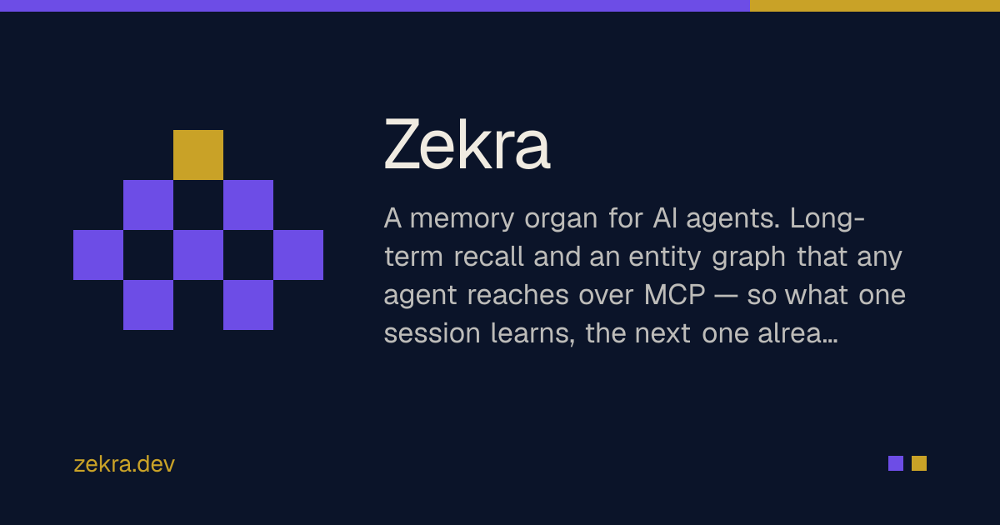
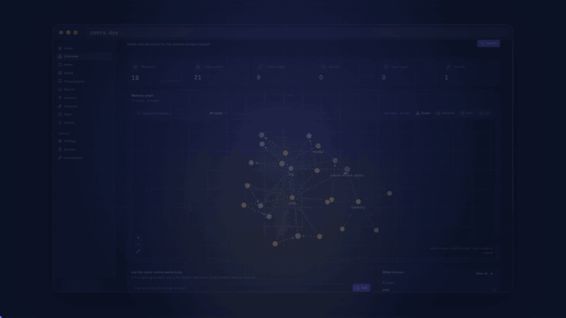

<div align="center">



# Zekra — ذكرى

**Shared long-term memory for AI agents. What one session learns, the next one already knows.**

Zekra is a memory service that any agent (Claude Code, Codex, Gemini, Cursor, your own fleet)
reaches over **MCP**. It stores what agents and people learn, deduplicates and updates it on
write, and returns the right memory on recall, with citations.

[](https://to-go.dev)
[](https://github.com/togo-framework/togo)
[](https://github.com/fadymondy/zekra/actions/workflows/ci.yml)
[](LICENSE)
[](https://discord.gg/99JBJd6FsR)
[](https://github.com/fadymondy/zekra/stargazers)

[Website](https://zekra.dev) · [Docs](https://zekra.dev/en/docs) · [Discord](https://discord.gg/99JBJd6FsR) · [Discussions](https://github.com/fadymondy/zekra/discussions) · [Issues](https://github.com/fadymondy/zekra/issues)

<p align="center">
  
</p>

</div>

## Features

- **Retain / recall** — hybrid retrieval: dense vectors + multilingual BM25 fused with RRF,
  a salience nudge, reranking, and 1-hop entity expansion. A write-decision step
  (ADD / UPDATE / INVALIDATE / NOOP) updates contradicted facts instead of duplicating them.
  Nothing is hard-deleted: `forget` soft-invalidates and history stays queryable.
- **Many brains** — one namespace per project or team, with per-agent grants and access
  tokens (`cbt_…`) enforced server-side.
- **Knowledge graph** — entities and typed relations extracted from memories, with
  traverse / neighbors / path / ontology queries and a graph "spine".
- **Data sources** — connectors (`text`, `markdown`, `crawler`, `github`, `sql`, `webhook`)
  pull external content, chunk it and retain it through the same write pipeline.
  See [Data sources](./docs/data-sources.md).
- **Chat with a brain** — a tool-calling agent that uses the brain's own recall / search /
  graph / retain as tools and answers with citations and an auditable trace.
- **Knowledge gaps, secrets vault, activity log** — plus a web console to manage it all.
- **Tiers** — Redis L1 working-memory cache, hot Postgres tier, object-store cold tier.

## Quick start

### Hosted

Sign up at **[app.zekra.dev](https://app.zekra.dev)**, create a brain and mint a token, then
connect your agent:

```bash
curl -fsSL https://app.zekra.dev/install.sh | sh     # installs the `zekra` CLI
zekra auth login --token <cbt_…>
zekra mcp:install claude-code                        # or claude-desktop | codex | gemini | cursor
```

The CLI lives in [`fadymondy/zekra-cli`](https://github.com/fadymondy/zekra-cli).

### Self-host with Docker Compose

Requirements: Docker with Compose v2, and about 6 GB of disk for the embedding and reranker
models.

```bash
git clone https://github.com/fadymondy/zekra.git && cd zekra
cp .env.selfhost.example .env.selfhost
# fill in POSTGRES_PASSWORD, AUTH_SECRET, ZEKRA_SECRETS_KEY and MFA_CHALLENGE_SECRET
# (generate each with: openssl rand -hex 32), and your email in ADMIN_EMAILS
docker compose -f docker-compose.selfhost.yml --env-file .env.selfhost up -d --build
```

Open http://localhost:3020 and register. The stack runs Postgres 17 with VectorChord, a
one-shot schema job, the Go API, the Next.js console and two CPU
[TEI](https://github.com/huggingface/text-embeddings-inference) servers (embeddings and
reranking), which download their models on first start. Then mint a token under
**Admin → Tokens** and run `zekra auth login --url http://localhost:3020 --token cbt_…`.

For a public deployment, put a TLS reverse proxy in front and set `APP_URL`. Every setting is
covered in [docs/self-hosting.md](docs/self-hosting.md) and [DEPLOY.md](DEPLOY.md).

### MCP tools

MCP tools include `memory_retain`, `memory_recall`, `memory_get`, `memory_forget`,
`memory_share`, `memory_edit`, `graph_*`, `memory_gaps`, `brain_*` (list, grants, tokens,
chat), `secret_*` and `datasource_*`. Full reference: [MCP server](./docs/mcp.md) · contracts: [`contracts/tools.md`](./contracts/tools.md).

## Architecture

```
  Claude Code · Codex · Cursor · your agents        web console · mobile · desktop · extension
          │ MCP (Streamable HTTP or stdio)                    │ REST / GraphQL / SSE
          └───────────────────────┬───────────────────────────┘
                 ┌────────────────▼─────────────────────────────────────┐
                 │ Go API (ToGO: plugins on a microkernel)               │
                 │  brain plugin: retain → write-decision (ADD/UPDATE/    │
                 │  INVALIDATE/NOOP) · recall: vectors + BM25 → RRF →    │
                 │  rerank → 1-hop graph · graph · data sources · chat   │
                 └──────┬──────────────────┬─────────────────┬───────────┘
                        │                  │                 │
           ┌────────────▼──────┐   ┌───────▼──────┐   ┌──────▼─────────┐
           │ Postgres + vchord │   │ TEI embed /  │   │ Redis L1 ·     │
           │ BM25 · partman    │   │ rerank       │   │ Cognee (opt.)  │
           └───────────────────┘   └──────────────┘   └────────────────┘
```

Zekra is a [ToGO](https://to-go.dev) app built from plugins:

| Part | Where | Role |
|---|---|---|
| `brain` | `plugins/brain` (module `github.com/togo-framework/brain`) | the memory organ: schema, retain/recall, graph, connectors, chat, REST |
| `brain-tei` | `plugins/brain-tei` | embeddings + rerank via TEI (Qwen3-Embedding-0.6B, bge-reranker-v2-m3) |
| `brain-cognee` | `plugins/brain-cognee` | entity / graph extraction engine (Cognee) |
| `cache-redis` | `plugins/cache-redis` | L1 cache |
| harness | `cmd/api`, `cmd/migrate`, `internal/`, `web/` | the app: API server, migrations, React console |
| `zekra-mcp` | `cmd/zekra-mcp` | stdio MCP server — thin adapter over the REST API |
| `zekractl` | `cmd/zekractl` | ops CLI: inspect DB, apply schema/BM25, BM25 smoke test, graph mirror |

Design: [`SPEC.md`](./SPEC.md) · decisions: [`contracts/internal/decisions.md`](./contracts/internal/decisions.md) ·
deploy: [`DEPLOY.md`](./DEPLOY.md).

### Built on ToGO

Zekra is built on **[ToGO](https://to-go.dev)** ([GitHub](https://github.com/togo-framework/togo)), the
open-source, API-first framework for Go + sqlc + Atlas + GraphQL/OpenAPI + Next.js with a
Laravel-style CLI. The kernel is small and everything else is a plugin; these are the pieces
Zekra uses:

| ToGO piece | What it does in Zekra |
|---|---|
| [Kernel](https://github.com/togo-framework/togo) | Config, the hook/event bus, the plugin registry and server bootstrap |
| [CLI](https://github.com/togo-framework/cli) | `togo generate` (sqlc → gqlgen → Atlas → OpenAPI), `togo serve`, `togo install` |
| [auth](https://github.com/togo-framework/auth) | Sign-in, JWT sessions, roles and API tokens; MFA, passkeys and OAuth come from the auth plugin family |
| [db-postgres](https://github.com/togo-framework/db-postgres) | The Postgres driver under the brain schema |
| [queue · cache · storage · mail](https://github.com/togo-framework) | Ingestion jobs, caching, media and transactional email |
| [Plugin model](https://to-go.dev/marketplace) | The memory organ itself ships as ToGO plugins: `brain`, `brain-tei`, `brain-cognee`, `cache-redis` |

Want the same foundation for your own app? Run `go install github.com/togo-framework/cli@latest && togo new myapp`,
then read the [ToGO docs](https://to-go.dev/en/docs) and browse the [plugin marketplace](https://to-go.dev/marketplace).

## Documentation

Full docs at **https://zekra.dev/en/docs** (source: [`docs/`](./docs)):

- [Introduction](./docs/index.md) and [Quickstart](./docs/quickstart.md)
- [MCP server](./docs/mcp.md): tool reference and client setup
- [CLI](./docs/cli.md): the `zekra` command and the Claude Code plugin
- [REST API](./docs/api.md): endpoints, errors, events, TypeScript client
- [Data sources](./docs/data-sources.md) · [Capture hook](./docs/capture-hook.md) ·
  [Security](./docs/security.md) · [Self-hosting](./docs/self-hosting.md)

## Contributing

Bug reports, docs and code contributions are all welcome. Start with
[CONTRIBUTING.md](CONTRIBUTING.md), which covers setup, conventions and the DCO sign-off. Then
look for a [`good first issue`](https://github.com/fadymondy/zekra/labels/good%20first%20issue).
AI coding agents should start with [AGENTS.md](AGENTS.md).

## Community

- [Discord](https://discord.gg/99JBJd6FsR): chat with the team and other users
- [GitHub Discussions](https://github.com/fadymondy/zekra/discussions): questions, ideas, show and tell
- [Issues](https://github.com/fadymondy/zekra/issues/new/choose): bugs and feature requests
- Security reports: see [SECURITY.md](SECURITY.md)

Please follow the [Code of Conduct](CODE_OF_CONDUCT.md).

## Sponsor

Zekra is free and open source, built and maintained by [Fady Mondy](https://github.com/fadymondy).
If it saves you time or powers your business, please consider supporting its development:

<p>
  <a href="https://github.com/sponsors/fadymondy"></a>
  <a href="https://buymeacoffee.com/fadymondy"></a>
</p>

Every sponsorship goes into maintenance, docs, translations and new features.

## License

Copyright (C) 2026 Fady Mondy. Zekra is free software, licensed under the
[GNU Affero General Public License v3.0](LICENSE) (`AGPL-3.0-only`). If you run a modified
version as a network service, you must offer its source to your users. Third-party
components keep their own licenses.

**Commercial licensing available:** for a license without the AGPL obligations, contact
[info@3x1.io](mailto:info@3x1.io).

## More open source from the same author

- [TomatoPHP](https://tomatophp.com): 60+ open-source FilamentPHP plugins for Laravel
- [Laravilt](https://laravilt.com): Laravel admin panels rendered with Inertia on Vue 3 or React 19
- [ToGO](https://to-go.dev): the Laravel-style workflow for Go + React apps, with a plugin marketplace

Built by [Fady Mondy](https://fadymondy.com).
